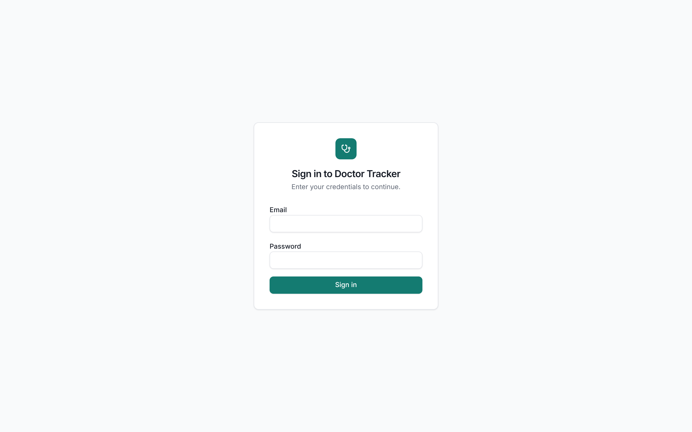
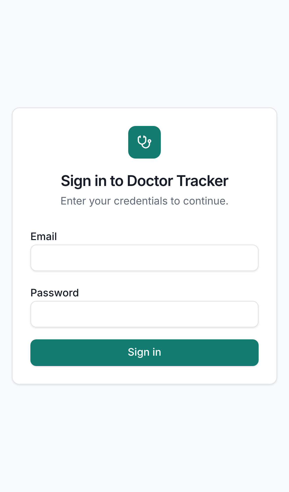
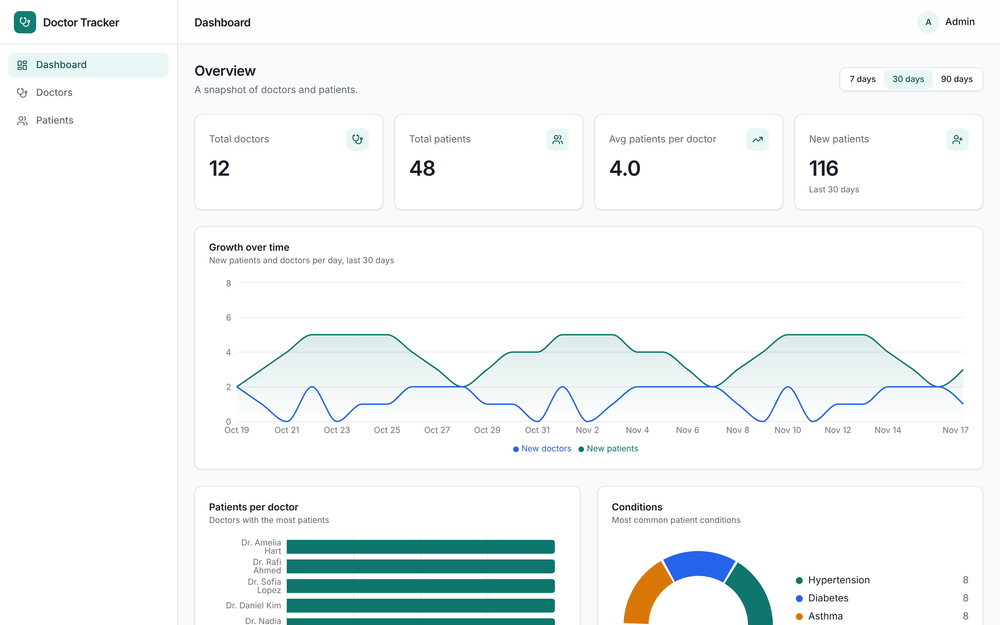
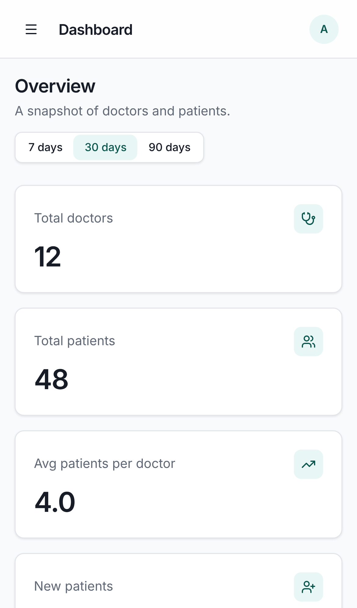
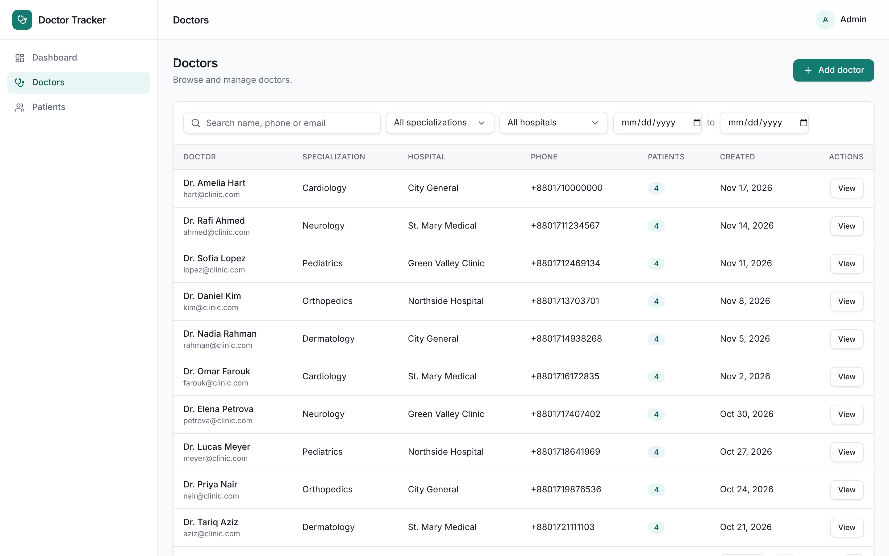
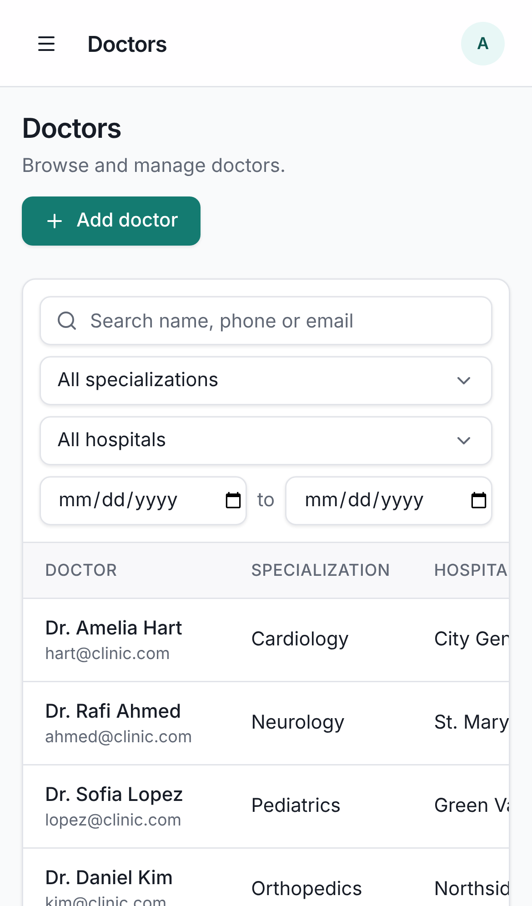
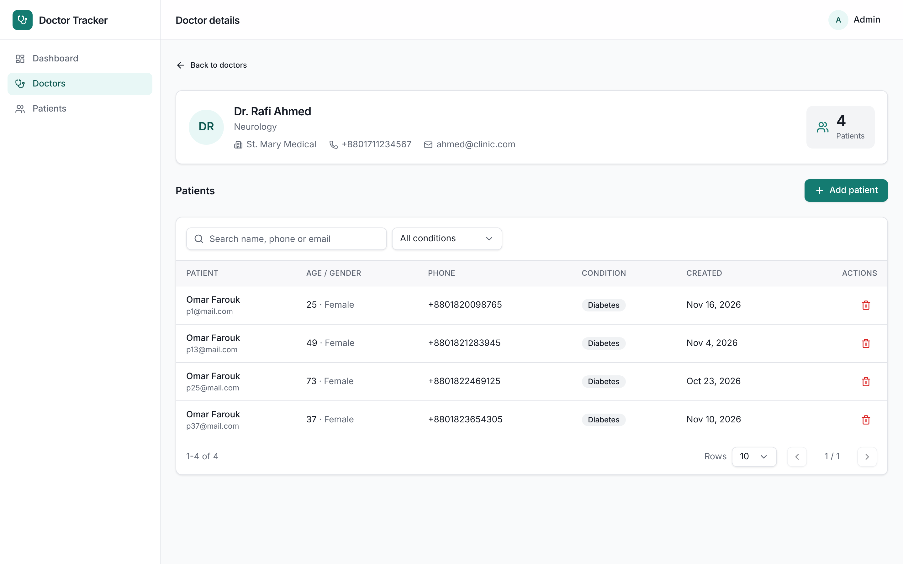
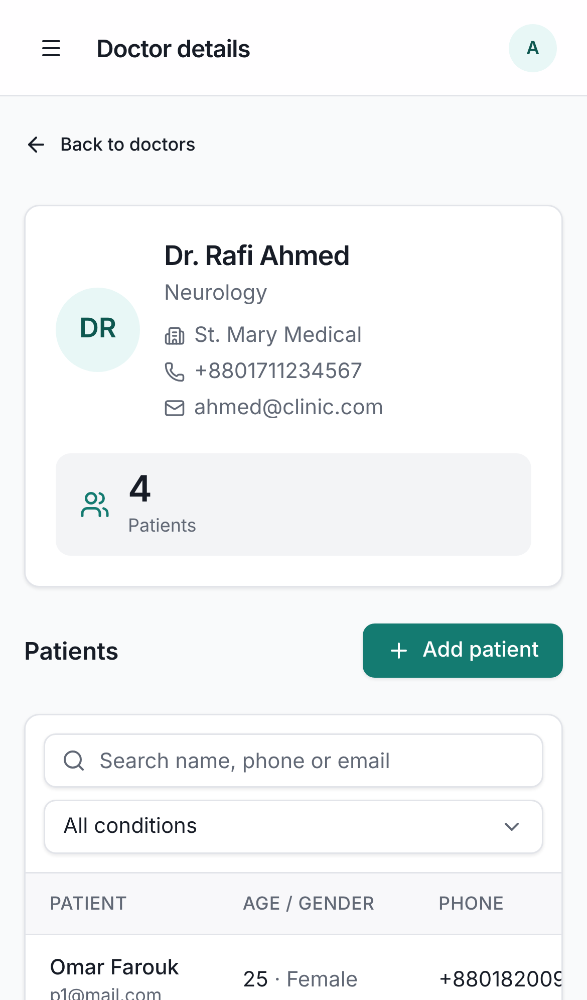
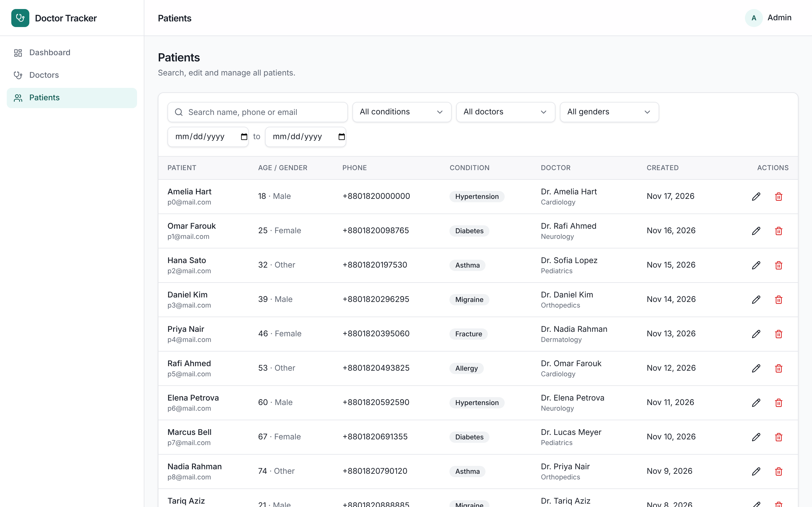
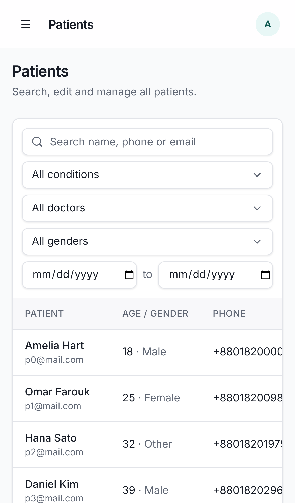

# Doctor Tracker

Doctor Tracker is a small admin portal for managing doctors and the patients assigned to them. An admin logs in, adds doctors, attaches patients to them, searches and filters everything, and gets a dashboard showing how patients and doctors are growing over time. It's a Next.js frontend talking to a separate Express + MongoDB API, both living in this repo.

## What's in the box

- Admin login with a JWT stored in an HttpOnly cookie, and protected pages
- Doctors list with search (name, phone, email), filters (specialization, hospital, date range) and pagination
- Doctor details page with that doctor's patients, plus add and delete patient
- Patients list with search, filters (condition, doctor, gender, date range), edit and delete
- Dashboard with totals and charts (patients over time, patients per doctor, common conditions)
- Filters and pages are kept in the URL, so refresh and back button just work

## Repo layout

```
doctor-tracker/
  backend/    Express + Mongoose API   (docs: backend/README.md)
  frontend/   Next.js app
  docs/       Screenshots used in this README
```

The API is documented in **[backend/README.md](backend/README.md)**: every endpoint, query params, request bodies, response and error format.

## Requirements

- Node.js 20 or newer
- npm
- A MongoDB database (local install or a free Atlas cluster)

Main tools used: Next.js 16 (App Router, TypeScript), React 19, Redux Toolkit with RTK Query, Tailwind CSS 4, shadcn/ui style components, Framer Motion, Recharts, Express 4, Mongoose, zod.

## Setup

**1. Backend**

```bash
cd backend
cp .env.example .env     # set MONGODB_URI and JWT_SECRET at least
npm install
npm run seed             # creates the admin user if it doesn't exist yet
npm run dev              # http://localhost:5000
```

**2. Frontend** (in a second terminal)

```bash
cd frontend
cp .env.example .env.local
npm install
npm run dev              # http://localhost:3000
```

Open http://localhost:3000 and sign in with the seeded admin. The defaults from `backend/.env.example` are:

| Email                   | Password    |
| ----------------------- | ----------- |
| admin@doctortracker.com | Admin@12345 |

Please change these (and `JWT_SECRET`) before deploying anywhere real. Running the seed again is safe: it won't create a second admin.

### Environment variables

| Where    | Variable                       | What it's for                                                         |
| -------- | ------------------------------ | --------------------------------------------------------------------- |
| backend  | `PORT`                         | API port (5000)                                                       |
| backend  | `MONGODB_URI`                  | MongoDB connection string                                             |
| backend  | `JWT_SECRET`, `JWT_EXPIRES_IN` | Signing login tokens                                                  |
| backend  | `CLIENT_URL`                   | Frontend origin allowed by CORS (must match the frontend URL exactly) |
| frontend | `NEXT_PUBLIC_API_URL`          | Where the API lives (`http://localhost:5000/api/v1`)                  |

### Production build

```bash
cd backend && npm start
cd frontend && npm run build && npm start
```

## System Architecture

```
Browser (Next.js, Redux Toolkit + RTK Query)
        |  same-origin /api/v1  (Next.js rewrites it to the API)
        v
Express API  /api/v1   (auth via HttpOnly cookie)
  routes -> controllers -> services -> repositories -> Mongoose
        |
        v
     MongoDB
```

The two apps only talk over REST. Login sets an HttpOnly cookie holding the JWT, and every other API route requires it.

**Backend.** Each layer has one job. Routes wire up URLs, auth and validation. Controllers read the request and send the response. Services hold the business rules. Repositories are the only place that touches Mongoose. Errors are thrown as `ApiError`s and turned into one consistent JSON shape by a single error handler (validation, bad ids, duplicates and JWT problems included).

**Frontend.** Pages are thin and the real work lives in feature components. RTK Query handles fetching and caching, and a small auth slice holds the logged-in user. Reusable pieces (table, filters, pagination, search box, confirm dialog) are shared between the doctor and patient screens.

```
backend/src    config, models, routes, controllers, services, repositories, validators, middlewares, utils, seeds
frontend/src   app (routes), components (ui, layout, shared, features), store (slice + api), hooks, lib, types
```

**A typical request.** Say you type in the doctors search box: the input is debounced, the value goes into the URL, RTK Query sees the new params and calls `GET /doctors?search=...`, the API validates the query, the service asks the repository for the page and the count, and the response comes back as `{ data, meta }` for the table and pagination.

## Technical Decisions

**1. Indexes and query shape for the list endpoints.**
Doctor and patient lists are searched, filtered and paginated, so indexes are chosen to match those queries instead of indexing everything. Doctors have a unique email, a `{ specialization, hospital }` index for the filters, and `createdAt` for the default sort and date range. Patients have `{ doctor, createdAt }` for a doctor's patient list, plus `condition`, `createdAt` and `phone`. Lists use `.lean()` and run the page query and the count in parallel. Patient counts for the doctors on a page come from one grouped query, not one count per row, so there's no N+1. Search is an escaped, case-insensitive regex over name, phone and email. That's fine at this size, and it's the first thing I'd swap for a text or Atlas Search index if the data grew a lot.

**2. RTK Query instead of hand-written thunks.**
Nearly all frontend state is server data, so RTK Query does most of the work: caching, loading and error states, and tag-based invalidation. Adding or deleting a patient automatically refreshes the doctor list (patient count), the patient lists and the dashboard, with no manual refetching. Redux itself only keeps the small bit of real client state, the logged-in user. The login token never touches JavaScript: the API sets it as an HttpOnly, SameSite cookie, so an XSS bug can't read it. The browser calls the API directly with credentials: 'include', and the API allows the frontend origin through CORS with credentials enabled. The same cookie lets the Next.js proxy redirect logged-out visitors before a page renders.

## Visual Evidence

Screenshots come from a production build. The data in them is sample data, since I captured them against a stand-in API rather than a live database.

| Page           | Desktop                                                       | Mobile                                                       |
| -------------- | ------------------------------------------------------------- | ------------------------------------------------------------ |
| Login          |                   |                   |
| Dashboard      |           |           |
| Doctors        |               |               |
| Doctor details |  |  |
| Patients       |             |             |

## Known limitations

- A patient's email can't be cleared once it's set (an empty email is ignored on update).
- The doctor dropdowns on the patient screens load the first 50 doctors, which is the API's page limit.
- On small screens the tables scroll sideways instead of turning into cards.
